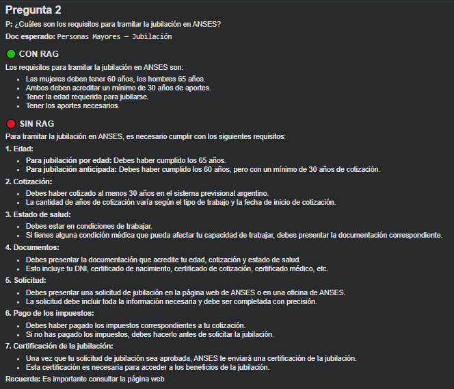
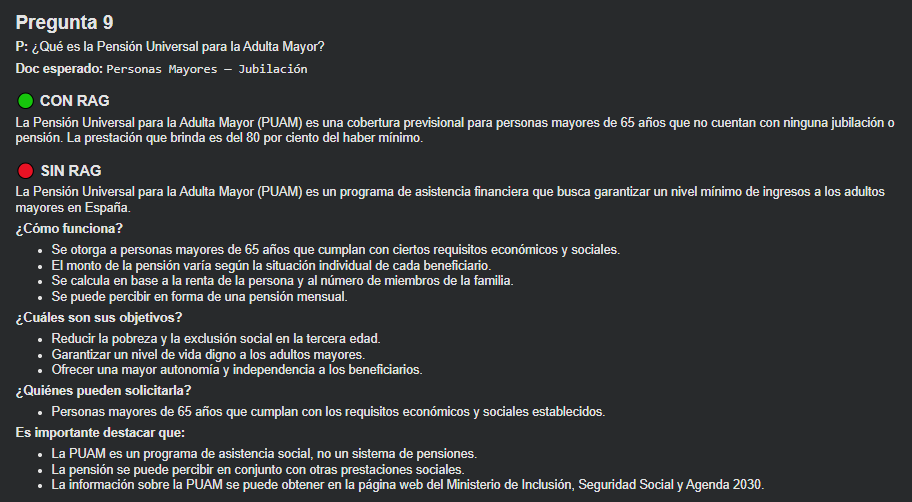
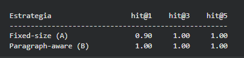

# RAG Assistant for Argentina's ANSES Rights Guide

[Leer en español](README.md)

Can a small language model answer questions about Argentine social security benefits **without making things up**? This project builds a Retrieval-Augmented Generation (RAG) system over the official guide *"ANSES en cada etapa de tu vida"* ("ANSES at every stage of your life") and compares it against the same model answering without access to the document.

*The notebook, the source document and the example questions and answers are in Spanish.*

## The problem

Social security regulation is extensive and confusing: ages, amounts, requirements, procedures. An LLM without context answers confidently, but often with data from another country or plain wrong. The idea is to ground its answers in the official document.

## Main result

On 10 questions answerable from the guide, manually annotated (Correct / Partial / Incorrect / Hallucination):

| | Correct | Partial | Hallucinations |
|---|:---:|:---:|:---:|
| **With RAG** | 8 / 10 | 2 / 10 | 0 / 10 |
| **Without RAG** | 2 / 10 | 0 / 10 | 8 / 10 |

Without RAG, the model tended to describe pension systems from other countries (for example, it attributed Argentina's universal pension for older adults, the PUAM, to Spain). With RAG it answered from the guide, and when the data was not in the retrieved context it said so instead of inventing it.

## How it works

1. **Corpus:** a 116-page PDF, cleaned (duplicated characters caused by bold-text extraction are fixed, page numbers are removed) and grouped into 8 thematic documents.
2. **Chunking:** two strategies were compared.
   - *Fixed-size:* 500-character windows with 100 characters of overlap (141 chunks).
   - *Paragraph-aware:* groups whole paragraphs up to 300 tokens, with 120 tokens of overlap (78 chunks).
3. **Embeddings and index:** `BAAI/bge-m3` + FAISS (`IndexFlatIP`, cosine similarity).
4. **Generation:** `google/gemma-2-2b-it` with a prompt that forces it to use only the retrieved context (top-5 passages) and to answer "No tengo información suficiente" ("I don't have enough information") when the answer isn't there.

### Retrieval: hit@k

| Strategy | hit@1 | hit@3 | hit@5 |
|---|:---:|:---:|:---:|
| Fixed-size | 0.90 | 1.00 | 1.00 |
| Paragraph-aware | **1.00** | 1.00 | 1.00 |

## Error analysis

The most interesting case was the question about the age limit for the AUH (child allowance). Retrieval worked (the right chunk ranked first), but that chunk started with a different benefit that mentions "up to 17 years old", and the token limit cut it off before reaching the AUH data. The model took the first number it saw. It is a **chunking** problem, not a retrieval or generation one.

The question about the documents required for the Maternity Allowance has no answer in the guide, and the system correctly recognized that.

## Limitations

- **Small evaluation:** 10 questions, manually annotated. Useful for comparing strategies, not for claiming generality.
- **Document-level hit@k:** with only 8 documents, hit@3 and hit@5 saturate at 1.00. The informative difference is at hit@1.
- A single corpus and a single 2B-parameter LLM.

## Next steps

- Annotate the correct *chunk* (not just the document) to measure retrieval at a finer resolution.
- Try `gemma-2-9b-it` and other chunking strategies (by headings or by benefit).
- Automatic evaluation with an LLM-as-judge to scale up the question set.
- Add ANSES's official resolutions to cover what the guide leaves out.

## How to run

1. Open the notebook in Colab with the badge above and choose a GPU runtime.
2. Gemma 2 is a gated model: accept the license at [huggingface.co/google/gemma-2-2b-it](https://huggingface.co/google/gemma-2-2b-it) and create a read token.
3. Store the token in Colab **Secrets** (key icon) under the name `HF_TOKEN`.
4. Run the cells in order. The PDF is downloaded automatically from Drive.

## Stack

Python · `pdfplumber` · `sentence-transformers` (BAAI/bge-m3) · FAISS · Hugging Face `transformers` (Gemma 2 2B) · Google Colab

## Data source

*ANSES en cada etapa de tu vida*, rights guide from Argentina's national social security administration (ANSES), August 2023 edition.
