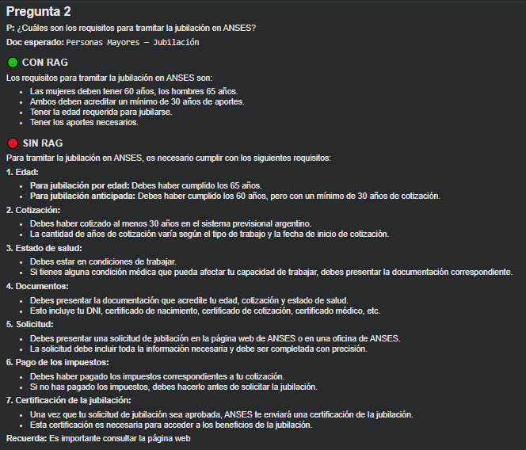
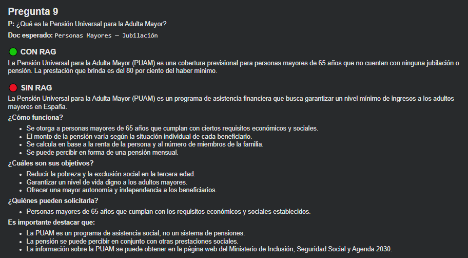
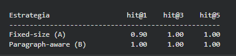

# Asistente RAG sobre la Guía de Derechos de ANSES

¿Puede un modelo chico responder dudas sobre prestaciones de la seguridad social argentina **sin inventar datos**? Este proyecto construye un sistema de *Retrieval-Augmented Generation* (RAG) sobre la guía oficial *"ANSES en cada etapa de tu vida"* y lo compara contra el mismo modelo respondiendo sin acceso al documento.

## El problema

La normativa de seguridad social es extensa y genera confusión: edades, montos, requisitos, trámites. Un LLM sin contexto responde con seguridad, pero muchas veces con datos de otro país o directamente falsos. La idea es anclar las respuestas al documento oficial.

## Resultado principal

Sobre 10 preguntas con respuesta en la guía, anotadas manualmente (Correcta / Parcial / Incorrecta / Alucinación):

| | Correctas | Parciales | Alucinaciones |
|---|:---:|:---:|:---:|
| **Con RAG** | 8 / 10 | 2 / 10 | 0 / 10 |
| **Sin RAG** | 2 / 10 | 0 / 10 | 8 / 10 |

Sin RAG, el modelo tendía a describir sistemas previsionales de otros países (por ejemplo, atribuyó la Pensión Universal para el Adulto Mayor a España). Con RAG respondió con los datos de la guía, y cuando el dato no estaba en el contexto lo dijo en lugar de inventarlo.

## Cómo funciona

1. **Corpus:** PDF de 116 páginas, limpiado (se corrigen caracteres duplicados por la extracción de negritas, se eliminan números de página) y agrupado en 8 documentos temáticos.
2. **Chunking:** se compararon dos estrategias.
   - *Fixed-size:* ventanas de 500 caracteres con 100 de overlap (141 chunks).
   - *Paragraph-aware:* agrupa párrafos completos hasta 300 tokens, con 120 de overlap (78 chunks).
3. **Embeddings e índice:** `BAAI/bge-m3` + FAISS (`IndexFlatIP`, similitud coseno).
4. **Generación:** `google/gemma-2-2b-it` con un prompt que lo obliga a usar solo el contexto recuperado (top-5 fragmentos) y a responder "No tengo información suficiente" si el dato no aparece.

### Retrieval: hit@k

| Estrategia | hit@1 | hit@3 | hit@5 |
|---|:---:|:---:|:---:|
| Fixed-size | 0.90 | 1.00 | 1.00 |
| Paragraph-aware | **1.00** | 1.00 | 1.00 |

## Análisis de errores

El caso más interesante fue la pregunta sobre hasta qué edad se cobra la AUH. El retrieval funcionó (el chunk correcto salió primero), pero ese chunk empezaba con otra prestación que mencionaba "hasta los 17 años", y el límite de tokens cortaba antes de llegar al dato de la AUH. El modelo tomó el primer número que vio. Es un problema de **chunking**, no de recuperación ni de generación.

La pregunta sobre documentos para la Asignación por Maternidad no tiene respuesta en la guía, y el sistema lo reconoció correctamente.

## Limitaciones

- **Evaluación chica:** 10 preguntas, anotadas a mano. Sirve para comparar, no para afirmar generalidad.
- **hit@k a nivel de documento:** con solo 8 documentos, hit@3 y hit@5 saturan en 1.00. La diferencia informativa está en hit@1.
- Un solo corpus y un solo LLM de 2B parámetros.

## Próximos pasos

- Anotar el *chunk* correcto (no solo el documento) para medir retrieval con más resolución.
- Probar `gemma-2-9b-it` y otras estrategias de chunking (por títulos o por prestación).
- Evaluación automática con LLM-as-judge para escalar el set de preguntas.
- Sumar las resoluciones oficiales de ANSES para cubrir lo que la guía omite.

## Cómo ejecutarlo

1. Abrí el notebook en Colab con el botón de arriba y elegí un entorno con GPU.
2. Gemma 2 es un modelo restringido: aceptá la licencia en [huggingface.co/google/gemma-2-2b-it](https://huggingface.co/google/gemma-2-2b-it) y creá un token de lectura.
3. Guardá el token en **Secretos** de Colab (ícono de llave) con el nombre `HF_TOKEN`.
4. Ejecutá las celdas en orden. El PDF se descarga automáticamente desde Drive.

## Stack

Python · `pdfplumber` · `sentence-transformers` (BAAI/bge-m3) · FAISS · Hugging Face `transformers` (Gemma 2 2B) · Google Colab

## Fuente de datos

*ANSES en cada etapa de tu vida*, Guía de derechos de la Administración Nacional de la Seguridad Social, edición agosto 2023.
